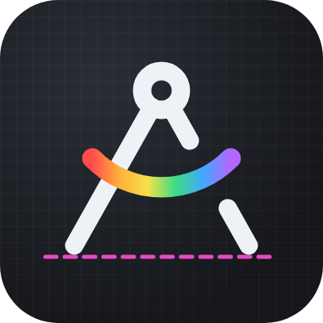
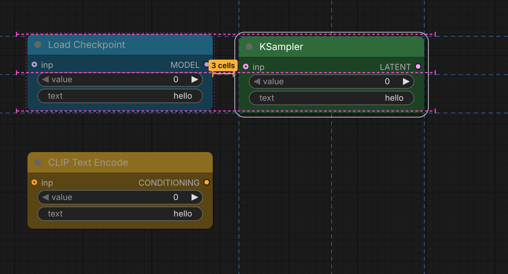
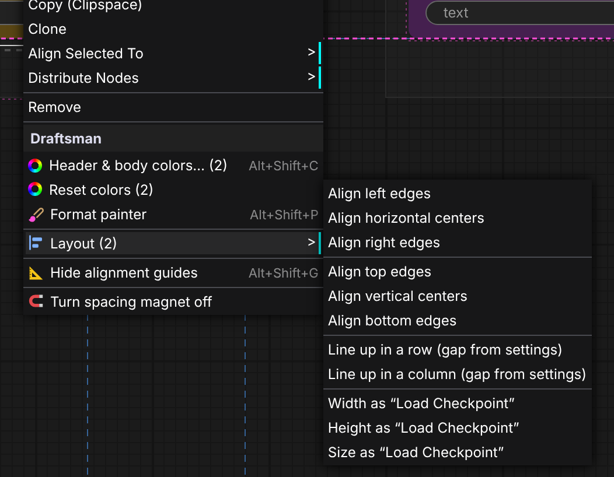
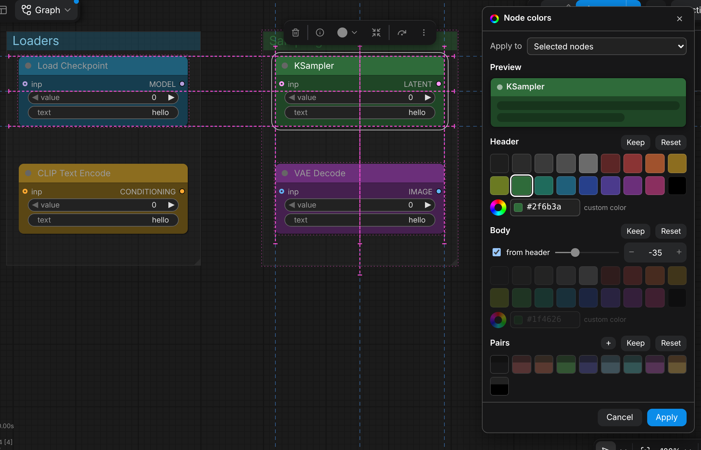
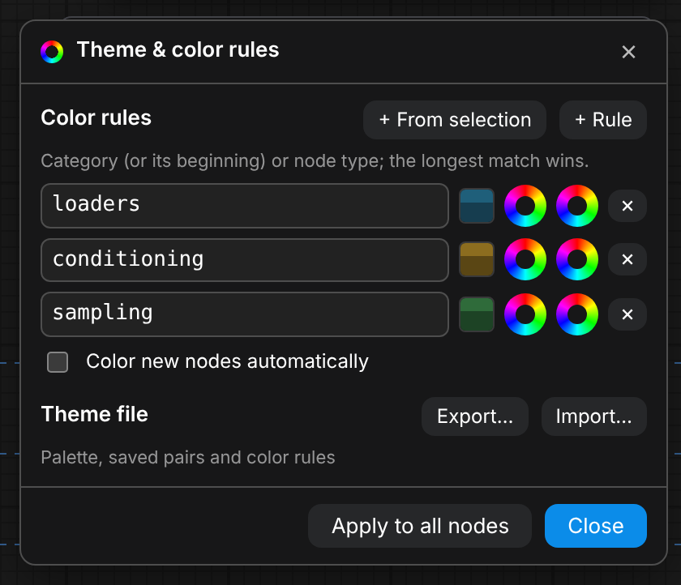

# ComfyUI-Draftsman

**English** · [Русский](README.ru.md)

Styling and layout tools for the ComfyUI graph: separate header and body colors for nodes **and groups**,
a format painter, color rules and theme files, alignment guides, a spacing magnet, and align / line up /
same size / fit-group tools that work in grid cells. The UI is available in English and Russian.

## Installation
- **ComfyUI-Manager:** Custom Nodes Manager → search for “Draftsman” → Install.
- **comfy-cli:** `comfy node install comfyui-draftsman`
- **Manually:** `git clone https://github.com/ScrudgMcDack/ComfyUI-Draftsman` into `ComfyUI/custom_nodes/`.

Restart ComfyUI afterwards. There are no Python dependencies — this is a frontend-only extension.

## Language
Follows the ComfyUI **Comfy.Locale** setting: `ru` gives Russian, any other locale falls back to English.
Menus, dialogs and canvas labels switch immediately; setting and command names switch after a ComfyUI restart.

## Context menu
Everything lives in one **Draftsman** block, with hotkey hints on the right (they follow your own key bindings).

| Where | What |
|---|---|
| Right-click a node | header & body colors · reset · format painter · Layout ▸ · guides · spacing magnet |
| Right-click a group | group colors · color the group's nodes · reset · format painter · fit group to nodes · theme & rules |
| Right-click the canvas | colors of the selection · theme & color rules · Layout ▸ · guides · spacing magnet |

## Colors

- **Nodes:** header → `node.color`, body → `node.bgcolor` (stock LiteGraph fields, so colors stay in the workflow
  and show up even without the extension). **Groups:** header → `group.color`, body → `group.flags.dm_body`.
- **Color dialog** (`Alt+Shift+C`): apply to the selection, all nodes of a type, all nodes of a group or the whole
  graph; live preview; swatches, a custom color picker, “body from header” with a lightness shift; saved pairs;
  Keep / Reset per part. Esc reverts, Ctrl+Z undoes an applied change in one step.
- **Format painter** (`Alt+Shift+P` or the menu): takes the style of a node or group, then every node or group you click
  gets it. Esc, right-click or a click on empty canvas exits.
- **Theme & color rules** (canvas menu): a rule maps a category (or its beginning, e.g. `loaders`) or a node type to a
  header and body color; the longest match wins. “Apply to all nodes” recolors the graph, “Color new nodes
  automatically” colors nodes as you add them (workflows being loaded are left alone).
- **Theme export / import:** `draftsman-theme.json` with the palette, lightness shift, pairs and rules.
- **Copy / Paste colors** are hidden by default — the format painter covers the one-by-one case. Turn them on in
  Settings for the extended mode: paste a style into the whole selection at once and carry it between workflow tabs.

## Layout
The **Layout ▸** submenu (two or more selected nodes):
- align left / right / top / bottom edges or centers;
- **line up in a row / column** with the gap from the settings (node gap inside a group, group gap across groups);
- same width / height / size — from a node's menu as that node, from the canvas menu as the largest one.

**Fit group to nodes (grid):** padding in cells (1 by default) plus the group header. With 1 cell of padding and
1 cell between groups, nodes of neighbouring groups end up exactly 3 cells apart side by side and 6 cells apart
stacked — matching the spacing magnet.

**Arrow keys** move the selection (nodes and groups) by 1 cell, with Shift by 5 cells (configurable).

## Alignment guides and spacing magnet
- Dashed extensions of the selection edges, a bright dashed line when edges or centers match other nodes or groups,
  and a snap on release (hold Shift to skip). `Alt+Shift+G` toggles the guides.
- The **spacing magnet** pulls a node or group to an exact number of grid cells from its neighbour: 3 / 3 inside a
  group, 3 between side-by-side groups, 6 between stacked groups (measured between the nodes closest to the facing
  group edges). An orange dimension line with a label shows when the magnet has caught.
- Works with the classic canvas and with Vue nodes (Nodes 2.0).

## Hotkeys
| Keys | Action |
|---|---|
| `Alt+Shift+C` | color dialog for the selection |
| `Alt+Shift+P` | format painter from the selected node or group |
| `Alt+Shift+G` | toggle alignment guides |
| `← → ↑ ↓` / `Shift + arrows` | move the selection by 1 / 5 cells |

All commands (`Draftsman: …`) can be rebound in Settings → Keybinding.

## Settings
Settings → **Draftsman**: Guides, Spacing, Layout, Colors. Each non-obvious setting has an ⓘ tooltip.

## Limitations
- The separate group header/body rendering replicates the stock group look of the 1.5x frontend.
- The node title text color is chosen by ComfyUI.

## License
MIT — see [LICENSE](LICENSE). Lucide icons are ISC-licensed, see [THIRD_PARTY_NOTICES.md](THIRD_PARTY_NOTICES.md).
