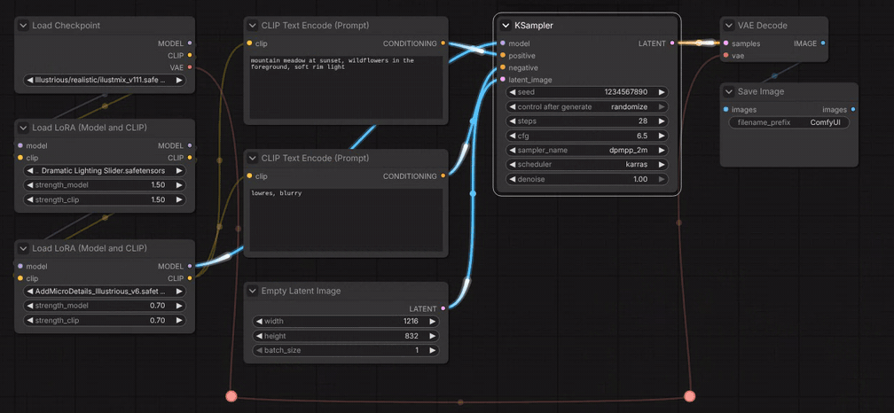
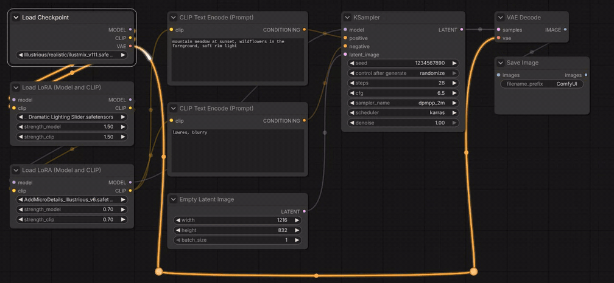
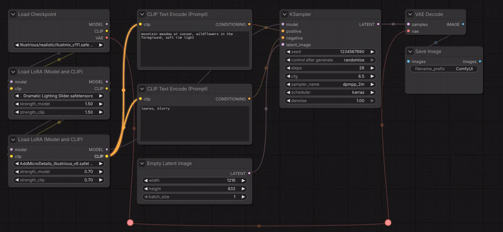

# ComfyUI-Draftsman

<p align="center">
  
</p>

<p align="center">
  <a href="https://github.com/ScrudgMcDack/ComfyUI-Draftsman/releases"></a>
  <a href="https://github.com/ScrudgMcDack/ComfyUI-Draftsman/releases"></a>
</p>

<p align="center"><b>English</b> · <a href="README.ru.md">Русский</a> · <a href="CHANGELOG.md">Changelog</a></p>

Styling and layout tools for the ComfyUI graph: separate header and body colors for nodes **and groups**,
a format painter, color rules and theme files, alignment guides, a spacing magnet, and align / line up /
same size / fit-group tools that work in grid cells. The UI is available in English and Russian.


## Installation
- **ComfyUI-Manager:** Custom Nodes Manager → search for “Draftsman” → Install.
- **comfy-cli:** `comfy node install comfyui-draftsman`
- **Manually:** `git clone https://github.com/ScrudgMcDack/ComfyUI-Draftsman` into `ComfyUI/custom_nodes/`.

Restart ComfyUI afterwards. There are no Python dependencies — this is a frontend-only extension.

## Language
Follows the ComfyUI **Comfy.Locale** setting: `ru` gives Russian, any other locale falls back to English.
Menus, dialogs and canvas labels switch immediately; setting and command names switch after a ComfyUI restart.

## Context menu
Everything lives in one **Draftsman** block under its drafting-compass label, with hotkey hints on the right (they
follow your own key bindings). The block stays in one piece even when other extensions put their items into the same
menu.


| Where | What |
|---|---|
| Right-click a node | header & body colors · reset · format painter · Layout ▸ · guides · spacing magnet |
| Right-click a group | color frame of group · color nodes in group · reset · Group shape ▸ · format painter · fit group to nodes · theme & rules |
| Right-click the canvas | colors of the selection · theme & color rules · Layout ▸ · guides · spacing magnet |

## Colors


- **Nodes:** header → `node.color`, body → `node.bgcolor` (stock LiteGraph fields, so colors stay in the workflow
  and show up even without the extension). **Groups:** header → `group.color`, body → `group.flags.dm_body`.
- **Color dialog** (`Alt+Shift+C`): apply to the selection, all nodes of a type, all nodes of a group or the whole
  graph; live preview; swatches, a custom color picker, “body from header” with a lightness shift; saved pairs;
  Keep / Reset per part. Esc reverts, Ctrl+Z undoes an applied change in one step.
- **Format painter** (`Alt+Shift+P` or the menu): takes the style of a node or group, then every node or group you click
  gets it. Esc, right-click or a click on empty canvas exits.
- **Theme & color rules** (canvas menu): a rule maps a category (or its beginning, e.g. `loaders`) or a node type to a
  header and body color; the longest match wins. “Apply to all nodes” recolors the graph, “Color new nodes
  automatically” colors nodes as you add them (workflows being loaded are left alone).
- **Theme export / import:** `draftsman-theme.json` with the palette, lightness shift, pairs and rules.
- **Copy / Paste colors** are hidden by default — the format painter covers the one-by-one case. Turn them on in
  Settings for the extended mode: paste a style into the whole selection at once and carry it between workflow tabs.


## Group shape
**Group shape ▸** in the group menu sets the corners of the group, like the shapes of nodes: square (stock), round, or
card (top-left and bottom-right corners round). It applies to all selected groups, is kept in the workflow
(`group.flags.dm_shape`) and is undone with Ctrl+Z. Without Draftsman a group is drawn with square corners.

## Node collapse button
The dot at the left of a node header collapses the node; it is easy to miss, so Draftsman draws it as a button.
Settings → Draftsman → Nodes → **Collapse button in the node header**:
- **Button with a chevron** (default) — a chevron on a dark backing: down when the node is expanded, right when it is
  collapsed; hovered, the backing takes the color of the node body;
- **Plus / minus** — a framed − (expanded) or + (collapsed);
- **ComfyUI (stock dot)**.

The icon takes the color of the title text, so it stays visible on colored headers. Only the look changes: the click
area and the collapsing are stock. Nodes that draw their own button (e.g. subgraphs) keep it.

## Layout
The **Layout ▸** submenu (two or more selected nodes):
- align left / right / top / bottom edges or centers;
- **line up in a row / column** with the gap from the settings (node gap inside a group, group gap across groups);
- same width / height / size — from a node's menu as that node, from the canvas menu as the largest one.

**Fit group to nodes (grid):** padding in cells (1 by default) plus the group header. With 1 cell of padding and
1 cell between groups, nodes of neighbouring groups end up exactly 3 cells apart side by side and 6 cells apart
stacked — matching the spacing magnet.

**Arrow keys** move the selection (nodes and groups) by 1 cell, with Shift by 5 cells (configurable).

## Alignment guides and spacing magnet
- Dashed extensions of the selection edges, a bright dashed line when edges or centers match other nodes or groups,
  and a snap on release (hold Shift to skip). `Alt+Shift+G` toggles the guides.
- The **spacing magnet** pulls a node or group to an exact number of grid cells from its neighbour: 3 / 3 inside a
  group, 3 between side-by-side groups, 6 between stacked groups (measured between the nodes closest to the facing
  group edges). An orange dimension line with a label shows when the magnet has caught.
- While a node, a group or the canvas is dragged, the node description tooltip is hidden, so it does not cover the
  guides; it comes back after the drop.
- Works with the classic canvas and with Vue nodes (Nodes 2.0).

## Links
In a big workflow the links of one node are hard to follow, so Draftsman puts them in focus:
- **selected nodes** — their links are drawn bright and on top of the others, the other links are dimmed; incoming
  links are blue, outgoing ones orange, and a comet — a bright head with a fading tail — runs along each of them from
  the output to the input; the next one leaves only when the previous one has arrived (through reroutes it runs the
  whole way; links of one output start their comets together, so on a shared trunk they are one comet);
- **hovering an input or output** — only its links are highlighted.







Settings → Draftsman → Links: on/off, opacity of the other links, animation and its speed, the two colors (or keep
the data-type colors). The comets are drawn on their own transparent layer above the canvas at the screen rate, so
they move smoothly and the graph is not redrawn for them; they are hidden under the nodes as the links are.

## Styled output tooltips
Nodes that describe their outputs (for example [Rigstools](https://github.com/ScrudgMcDack/ComfyUI-Rigstools)) get a
short title and coloured lines about the current value in the output tooltip: green — what comes out, amber — a
substitute or a problem, grey — a note. Other tooltips (inputs, widgets, node titles, other nodes) are not changed.
Turn it off in Settings → Draftsman → Tooltips.

**For node authors.** Add a method to your node; nothing else is needed and there is no dependency on Draftsman —
without it the stock tooltip is shown:

```js
nodeType.prototype.getStyledOutputTooltip = function (index) {
  // null — leave the stock tooltip as is
  return {
    title: "Seed",            // optional; default — the first paragraph of the stock tooltip
    lines: [{ kind: "info", text: "From the parameters: 1234" }],   // kind: "info" | "warn" | "muted"
  };
};
```

The frontend draws tooltips as plain text, so Draftsman shortens that text to the title and adds the lines next to it.
This relies on the tooltip markup of the frontend (`.node-tooltip`); if a frontend update changes it, the stock
tooltip is shown again.

## Hotkeys
| Keys | Action |
|---|---|
| `Alt+Shift+C` | color dialog for the selection |
| `Alt+Shift+P` | format painter from the selected node or group |
| `Alt+Shift+G` | toggle alignment guides |
| `← → ↑ ↓` / `Shift + arrows` | move the selection by 1 / 5 cells |

All commands (`Draftsman: …`) can be rebound in Settings → Keybinding.

## Settings
Settings → **Draftsman**: Guides, Spacing, Layout, Colors, Links, Tooltips, Nodes. Each non-obvious setting has an ⓘ tooltip.

## Limitations
- The separate group header/body rendering replicates the stock group look of the 1.5x frontend.
- The node title text color is chosen by ComfyUI.

## License
MIT — see [LICENSE](LICENSE). Lucide icons are ISC-licensed, see [THIRD_PARTY_NOTICES.md](THIRD_PARTY_NOTICES.md).
