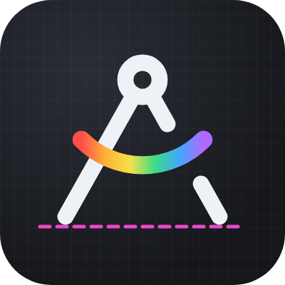

# ComfyUI-Draftsman

[English](README.md) · **Русский**

Инструменты оформления и раскладки графа ComfyUI:
раздельные цвета шапки и тела нод и групп, кисть формата, правила раскраски и темы,
направляющие, магнит интервалов, выравнивание и раскладка по клеткам.

## Установка
- **ComfyUI-Manager:** Custom Nodes Manager → найти «Draftsman» → Install.
- **comfy-cli:** `comfy node install comfyui-draftsman`
- **Вручную:** `git clone https://github.com/ScrudgMcDack/ComfyUI-Draftsman` в папку `ComfyUI/custom_nodes/`.

После установки перезапустите ComfyUI. Python-зависимостей нет — расширение чисто фронтендовое.

## Язык
Берётся из **Comfy.Locale**: `ru` — русский, любой другой — английский. Меню, диалоги и подписи на холсте
переключаются сразу, названия настроек и команд — после перезапуска ComfyUI (папка `locales/`).

## Контекстное меню
Все пункты собраны в блок **Draftsman**:

| Где | Что |
|---|---|
| ПКМ по ноде | цвета шапки и тела · сбросить · кисть формата · Раскладка ▸ · направляющие · магнит |
| ПКМ по группе | цвета группы · раскрасить ноды группы · сбросить · кисть формата · подогнать группу по нодам · тема и правила |
| ПКМ по холсту | цвета выделенного · тема и правила · Раскладка ▸ · направляющие · магнит |

## Цвета
- **Ноды:** шапка `node.color`, тело `node.bgcolor`. **Группы:** шапка `group.color`, тело `group.flags.dm_body`.
- Диалог (`Alt+Shift+C`): кому применить, предпросмотр, образцы, свой цвет (цветовой круг),
  режим «тело из шапки», пары с кнопками «Не менять» / «Сброс».
- **Кисть формата** (`Alt+Shift+P` или пункт меню): берёт стиль ноды или группы, дальше кликайте по другим нодам
  и группам — они перекрашиваются. Выход — Esc, ПКМ или клик по пустому месту.
- **Тема и правила раскраски** (меню холста): правило = категория (или её начало, например `loaders`) либо тип ноды
  → цвет шапки и тела; побеждает самое длинное совпадение. «Применить ко всем нодам» перекрашивает граф,
  галка «Красить новые ноды автоматически» красит только что добавленные ноды (загружаемые workflow не трогает).
- **Экспорт / импорт темы** — файл `draftsman-theme.json`: палитра, сдвиг яркости, пары, правила.

## Раскладка
Подменю **Раскладка ▸** (2 и более выделенных нод):
- выровнять по левому / правому / верхнему / нижнему краю или центру;
- **выстроить в ряд / столбец** с интервалом из настроек (внутри группы — интервал нод,
  между группами — интервал групп);
- одинаковая ширина / высота / размер: из меню ноды — как у неё, из меню холста — по самой большой.

**Подогнать группу по нодам (по клеткам):** поля задаются в клетках (по умолчанию 1) плюс шапка группы.
При поле 1 и зазоре между группами в 1 клетку ноды соседних групп окажутся в 3 клетках сбоку
и в 6 клетках по вертикали — ровно по настройкам магнита.

**Стрелки** двигают выделение (ноды и группы) на 1 клетку, со Shift — на 5 (настраивается).

## Направляющие и магнит интервалов
- Пунктирные продолжения краёв выделения, яркий пунктир при совпадении краёв и центров, магнит при отпускании
  (Shift — без магнита). `Alt+Shift+G` — вкл/выкл.
- Магнит интервалов подтягивает ноду или группу на точное число клеток до соседа: 3 / 3 внутри,
  3 между группами рядом, 6 между группами одна под другой. Размерная линия с подписью показывает, что магнит «поймал».

## Горячие клавиши
| Клавиши | Действие |
|---|---|
| `Alt+Shift+C` | диалог цветов выделенного |
| `Alt+Shift+P` | кисть формата с выделенной ноды или группы |
| `Alt+Shift+G` | вкл/выкл направляющие |
| `← → ↑ ↓` / `Shift + стрелки` | сдвиг выделения на 1 / 5 клеток |

Все команды (`Draftsman: …`) можно переназначить в Settings → Keybinding. Назначенные клавиши
показываются подсказкой справа от пунктов меню и учитывают твои переназначения.

**Копировать / Вставить цвета** по умолчанию скрыты (хватает кисти формата). Включаются настройкой
«Показывать «Копировать / Вставить цвета» в контекстном меню» — для расширенного режима: вставка стиля
сразу во всё выделение и перенос стиля между вкладками workflow.

## Настройки
Settings → **Draftsman**: Направляющие, Интервалы, Раскладка, Цвета.

## Ограничения
- Раздельная отрисовка шапки и тела группы повторяет стандартный вид групп фронтенда 1.5x.
- Цвет текста заголовка ноды подбирает ComfyUI.

## Лицензия
MIT — см. [LICENSE](LICENSE). Иконки Lucide — ISC, см. [THIRD_PARTY_NOTICES.md](THIRD_PARTY_NOTICES.md).
